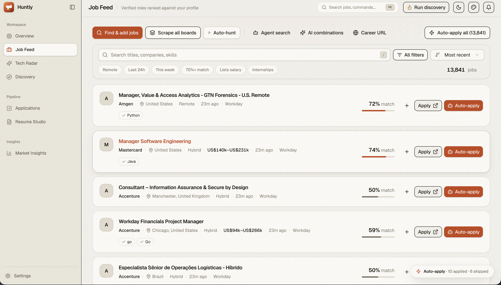
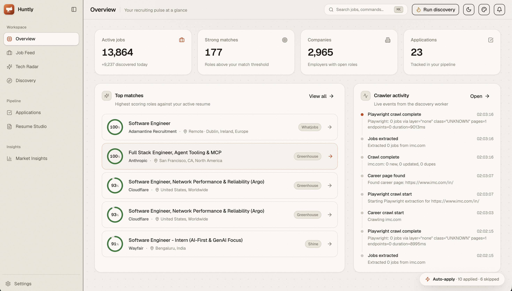
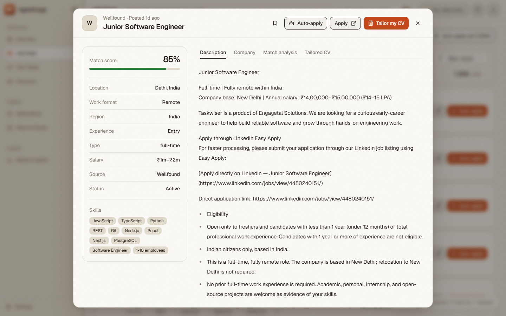
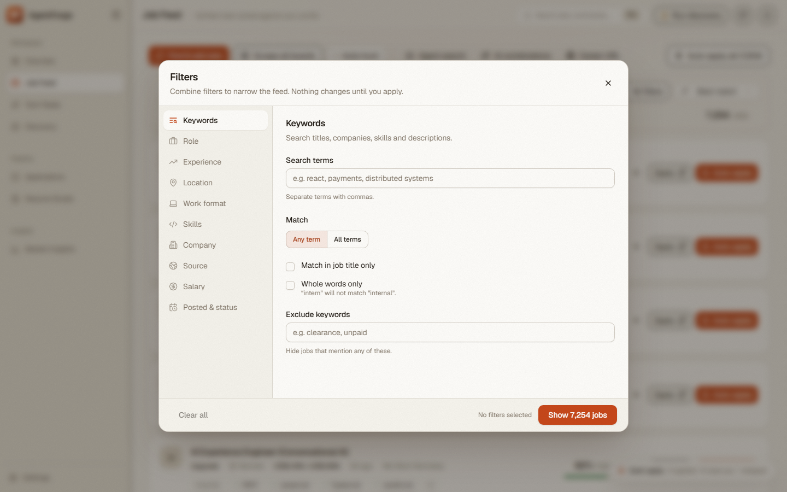
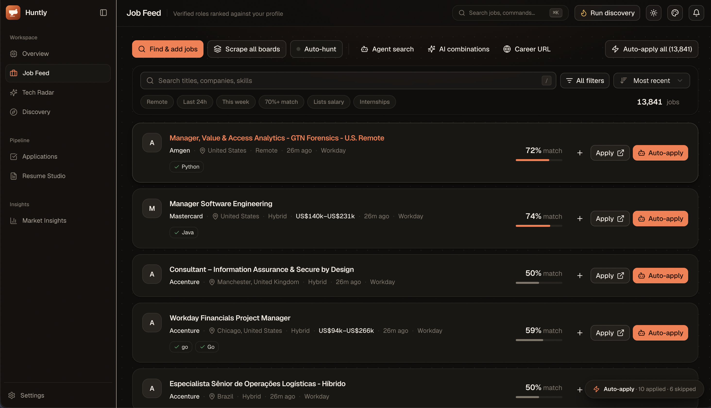

<p align="center">
  
</p>

<p align="center">
  A local-first workbench for the software job hunt. It crawls career pages and ATS boards, ranks roles against your resume, tailors your LaTeX CV with AI, and keeps every application in one place.
</p>

<p align="center">
  <a href="LICENSE"></a>
  
  
  
</p>

<p align="center">
  
</p>

<p align="center">
  
  
  
  
</p>

## Why AgentForge

Job boards show you everything and rank nothing for you. AgentForge runs on your machine, reads the sources you care about, and scores each role against your own resume. Your resume, API keys and application history never leave your computer, apart from the LLM calls you configure.

## Features

- **Job feed with match scores.** Weighted skill overlap against your active resume, with filters for role, seniority, location, work format, skills, company, source and salary.
- **Discovery engine.** Crawls company career pages. It prefers official ATS APIs (Greenhouse, Lever, Ashby), then falls back to captured network calls, embedded page data and HTML. Progress streams live.
- **Tech radar.** An AI-scanned feed of hiring and technology news.
- **Resume Studio.** Upload a LaTeX resume, tailor it to a job with AI, compile it to PDF, and draft cover letters and outreach messages.
- **Applications board.** A Kanban view of every role from saved to offer.
- **Auto-apply.** Fills application forms in a visible browser and waits for you to confirm. It never submits silently and never applies to the same job twice.
- **Market insights.** Skill demand, hiring companies and an application timeline.
- **Five themes.** Sand, Ocean, Forest, Dream, Graphite and Midnight, all driven by one set of CSS tokens.

## Quick start

### Option A: Local Development (Node.js)

You need Node 20 or newer and pnpm 9 or newer.

```bash
git clone <your-fork-url> agentforge
cd agentforge
pnpm install

cp .env.example .env        # add GEMINI_API_KEY and one search provider key
pnpm db:migrate             # creates the local SQLite database
pnpm dev:all                # API on :7842, UI on :1420
```

Open <http://localhost:1420>.

Optional steps:

```bash
npx playwright install chromium   # crawling and auto-apply
```

### Option B: Docker Compose

Run AgentForge with pre-configured Playwright Chromium, SQLite, and Node runtime in a single command:

```bash
cp .env.example .env        # add GEMINI_API_KEY and one search provider key
docker compose up -d
```

Open <http://localhost:1420>. Your SQLite database, uploaded resumes, and auto-apply state are persisted in the `agentforge-data` volume.

## Configuration

Copy `.env.example` to `.env`. The main variables are:

| Variable | Purpose |
|---|---|
| `GEMINI_API_KEY` | Resume tailoring, filter expansion, the tech radar and form answers |
| `SEARCH_PROVIDER` | `serper`, `serpapi` or `brave`, used for company discovery |
| `DATABASE_PATH` | Location of the SQLite file |
| `CRAWLER_CONCURRENCY`, `CRAWLER_REQUEST_DELAY_MS` | How politely the crawler behaves |

You can also set your Gemini key, LLM gateway, and search provider directly from the **Settings** screen.

### Targeting & Filter Criteria in Settings

You can customize your job hunt and crawler targeting rules from the **Settings** screen without editing config files:

- **Target Roles:** Comma-separated job titles (e.g. `Software Engineer, Backend Engineer, Full Stack Engineer`) used by crawlers to find relevant openings.
- **Target Locations:** Desired cities, countries, or `Remote`.
- **Minimum Match Threshold:** Set a score cut-off slider (e.g. `60%`) so roles below your resume match threshold are filtered out from highlights.
- **Crawl Interval:** Set the background schedule (1 to 48 hours) for automatic discovery passes.

## Project layout

```
apps/
  desktop/     React 19 + Vite + Tailwind v4 + shadcn/ui
  server/      Express API, crawlers, AI services, auto-applier
packages/
  database/    Drizzle schema and migrations (SQLite)
  shared/      Types, zod schemas and constants shared by both apps
docs/assets/   Logo, banner and screenshots
```

`SUMMARY.md` maps every feature to its files and API routes.

## Design system

The UI is built on shadcn/ui components. Every color, radius, shadow and font comes from CSS variables in `apps/desktop/src/index.css`, and the shadcn semantic tokens (`bg-card`, `text-muted-foreground`, `border-border`) resolve to them. To add a theme, define one `[data-theme="..."]` block of tokens. Do not hardcode colors in components.

- Fonts: Geist (UI) and Geist Mono (numbers and code)
- Motion: framer-motion, with `prefers-reduced-motion` respected
- Feedback: toasts for outcomes, confirmation dialogs for destructive actions

## Scripts

| Command | What it does |
|---|---|
| `pnpm dev:all` | Run the API and the UI together |
| `pnpm dev` / `pnpm dev:server` | Run one side only |
| `pnpm build:all` | Typecheck and build every package |
| `pnpm db:generate` / `pnpm db:migrate` / `pnpm db:studio` | Manage the schema |
| `pnpm seed` | Load demo data |

## Responsible use

Respect each site's terms of service and robots rules. Keep the crawler delay and concurrency conservative. Auto-apply is designed to keep a human in the loop, so review every application before it is submitted.

## Contributing

Issues and pull requests are welcome. See [CONTRIBUTING.md](CONTRIBUTING.md).

## License

[MIT](LICENSE)
